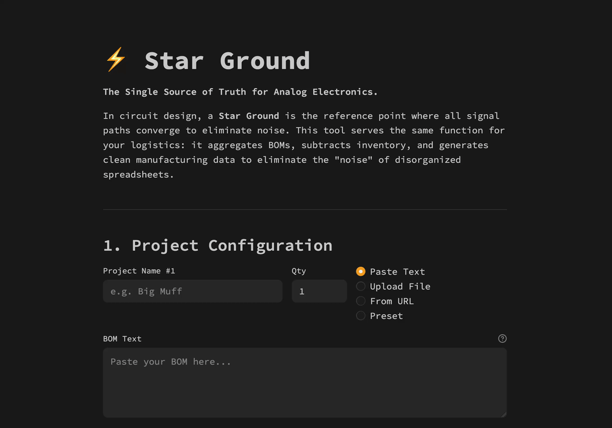

<!-- markdownlint-disable-file MD041 -->
<div align="center">

<picture>
  <source media="(prefers-color-scheme: dark)" srcset="assets/readme-dark.svg">
  <source media="(prefers-color-scheme: light)" srcset="assets/readme-light.svg">
  
</picture>

<br>

**A deterministic dependency manager for physical hardware manufacturing.**

[](https://github.com/JacksonFergusonDev/star-ground/releases)

[](https://github.com/JacksonFergusonDev/star-ground/actions/workflows/ci.yml)
[](https://github.com/JacksonFergusonDev/star-ground/actions/workflows/docker-publish.yml)
[](https://github.com/astral-sh/ruff)
[](https://mypy-lang.org/)
[](https://github.com/j178/prek)


</div>

> **In circuit design, a "Star Ground" is the single reference point where all signal paths converge to eliminate noise.**
>
> **In manufacturing, this application serves the same function: it is the Single Source of Truth for your inventory, eliminating the "noise" of disorganized BOMs and supply chain drift.**

---

## 📡 The Mission: Deterministic Procurement

In software, dependency resolution is **deterministic**: `uv sync` gives the same environment every time. In hardware, procurement is still manual: you copy parts lists by hand from several build documents, and one forgotten $0.01 resistor stalls a build weeks later.

*Star Ground* makes hardware logistics behave like software. Give it the build documents for the guitar pedals you plan to build, and it returns one shopping list, net of the parts you already own, plus printable build checklists and bin labels. Where it can't be sure it read a document right, it tells you exactly what to check.

**🚀 [Try the Live App](https://star-ground.streamlit.app/)**



> **Case Study:** This engine was the logistics backbone for [**Systems Audio Lab**](https://github.com/JacksonFergusonDev/systems-audio-lab), a project demonstrating the recursive engineering of physical instrumentation.

---

## 🛠 Features

### Inputs

- **Build documents (PDF):** upload a file or paste a link. The parser reads the build documents of five PCB publishers: **PedalPCB, GuitarPCB, Aion FX, Five Cats and Tonepad**. Links must be public `http(s)` addresses; GitHub, Google Drive and Dropbox share links work too. Tonepad's file links open a download page, so download those PDFs and upload them.
- **Pasted text and CSV:** any `REF VALUE` list (`R1 10k`, `C1-C3 100n`).
- **Presets:** a library of PedalPCB and Tayda circuits, browsable by source and category.
- **Your stock:** upload an inventory CSV, and only what you're missing is bought.

### Reading build documents

- **Ruled tables, borderless layouts and side-by-side lists**, including values that wrap onto a second line, ranges (`R1-R5`), lettered designators and named controls (`GAIN`, `P1-Crackle`).
- **Several circuits in one document** (Muffin Fuzz's versions, a Germanium and a Silicon list, a "Cleft mod"): the app asks which one you're building, and has no default.
- **Interchangeable parts** (through-hole or SMD, a bridge rectifier or four diodes): the document's first choice is used and the alternative is noted.
- **Image-only parts lists** are read by OCR, but only after you opt in, and every part OCR read is listed for you to check.
- **Parts that come with the PCB** are marked "included" and not bought.
- **Lists that count parts by value** (`4 - 10k` under a Resistors heading, as Tonepad prints most of its lists): each row is bought by its count, with no designator. A row whose kind neither its heading nor its value states (`1 - 4k7` under "Millbypass") is not guessed: it is listed for you to enter by hand.

### Review warnings

The parser's priority is **no silent errors**. Self-checks re-read each document independently and flag every place the shopping list might disagree with it, grouped by part:

- a designator printed in the document but missing from the list;
- a value that can't be parsed, or a part filed under the wrong category;
- a footnote or build note that changes a part for another version;
- a position offered with two parts ("install T2, not the Boost pot");
- a counted row (`1 - 4k7`) that couldn't be read, or rows OCR couldn't read.

### Outputs

- **Master shopping list**, merged across projects and quantities, with supplier search links and buying notes. It downloads as a CSV, with clickable Excel/Google Sheets links if you like.
- **Supplier cart file**: the parts to buy as a CSV for Mouser's or Digi-Key's BOM upload page. Parts named by a part number (`TL072`, `2N5088`) match directly; generic parts (resistors, capacitors, pots) come with a description to pick a match from.
- **Updated inventory CSV**: your stock after this build.
- **Field manuals:** printable checklists per project, sorted by component height (see below).
- **Sticker sheets:** Avery 5160 labels with condensed references (`R1-R4`) for binning parts.
- **Build pack:** one ZIP with all of the above and the source documents.

---

## ⚙️ Engineering Philosophy: Invariants over Inference

### 1. Determinism over Probabilistic Models (Why not LLMs?)

Supply chains have zero tolerance for hallucination. A 10k resistor cannot be "inferred" as 1k.

- **The Decision:** The parser reads word positions and table lines with `pdfplumber` and pairs designators with values by layout, with no language model involved. The same document always gives the same list.
- **The Rule:** The parser may be wrong, but never *silently*. When a document is ambiguous, it raises a review warning instead of guessing.

### 2. Measured, Not Assumed

Accuracy is graded against hand-labeled parts lists, not against the parser's own output.

- **The corpus:** every build document of the five publishers, about 1,240 PDFs and 60,000 labeled parts, with a separate tuning set and held-out test set for each publisher.
- **The metrics:** *silent errors* (a wrong or missing part with no warning) and *false alarms* (a warning on a correct part). On the labeled documents, both are zero.
- **The ratchet:** a committed corpus of 19 documents runs in CI, and any new failure, lost warning or false alarm fails the build.

### 3. Physical-Digital Isomorphism (Z-Height Sorting)

Most BOM tools sort lists alphabetically. **Star Ground** sorts by **physical height**.

- **The Insight:** PCB assembly goes best when low-profile parts (resistors, diodes) are soldered before tall ones (electrolytic capacitors, switches), so the board sits flat on the bench.
- **The Implementation:** The field manuals (`src/pdf_generator.py`) list parts in that order, optimizing the *human operator's* runtime.

### 4. Yield Management ("Nerd Economics")

The cost of a stockout (halting work for a $0.05 part) is far higher than the cost of a few spares. The sourcing engine applies a **category-specific buffer** to the net need only, never to parts you already own:

| Category | Rule |
|---|---|
| Resistors | +5, rounded up to the next 10 |
| Capacitors | +5; +10 for 100n bypass caps; +1 at 1µF and above |
| Diodes | +5, at least 10 |
| Transistors, crystals, optoelectronics | +1 (heat and fragile legs) |
| ICs | exact count, with a socket recommended |
| Inductors, transformers, relays | exact count |

A standard hardware kit (enclosure, jacks, DC jack, footswitch, status LED and its resistor, knobs, wire and so on) is added for each pedal. Anything the document lists itself is not added again.

### 5. Exact Units

Component values are written many ways (`4k7`, `4.7k`, `4700`, `4,700R`). A `pyparsing` grammar (`src/bom_lib/grammar/`) parses them into exact `Decimal` values, and `Pint` carries their units, so `4k7` and `4700` merge into one line and a voltage is never compared with a resistance.

### 6. Transparent Failure States

Errors are shown in the app, never swallowed. The in-app debug console shows the parser's log, and the log can be downloaded and attached to a GitHub issue.

---

## 🍷 Feature Spotlight: The "Silicon Sommelier"

Beyond parsing, the shopping list carries expert notes from a table of substitutions based on audio engineering practice:

- **Op-amps:** suggests hi-fi alternatives to generic chips (e.g., `TL072` → `OPA2134` for a lower noise floor).
- **Diodes:** suggests clipping diodes with a different character (e.g., `1N4148` → `1N4001` for a smoother clip, or an IR LED for more crunch).
- **Capacitors:** recommends a type by value and role (C0G/NP0 ceramic, box film, bulk 100n bypass caps).
- **Obsolete parts:** flags parts such as the `2N5457` and suggests replacements.

---

## 🛡️ Verification & Validation

1. **Ground-truth accuracy:** hand-labeled parts lists in `tests/golden/` grade every designator (correct, missing, extra, wrong category, wrong value) and check that each failure is warned. A baseline only ratchets upward. See [tests/golden/README.md](tests/golden/README.md).
1. **Snapshot regression:** sample PDFs are parsed in CI and diffed against stored JSON, so any change in output is reviewed.
1. **Property-based testing:** `Hypothesis` throws generated input at the parser, which must never crash, and at the buying math, which must stay sound.
1. **Headless integration:** `Streamlit.AppTest` drives the app (upload, build choice, OCR opt-in, Generate) without a browser.

See [tests/README.md](tests/README.md) for how to run each layer.

---

## 🔬 Tech Stack

- **Python 3.14**: strictly typed (`mypy --strict`)
- **uv**: dependency management and locking
- **Streamlit**: web interface
- **pdfplumber**: PDF words, lines and tables
- **RapidOCR**: OCR for image-only parts lists (ONNX runtime)
- **pyparsing, Pint**: value grammar and units
- **fpdf2**: field manuals and sticker sheets
- **Docker**: container image, published to GHCR on release
- **GitHub Actions**: Ruff, Mypy and pytest (accuracy ratchet, snapshots, Hypothesis, AppTest) on every PR

---

## 📦 Project Structure

```text
.
├── app.py                 <-- Streamlit web app (a frontend on src/api.py)
├── assets/                <-- Images and demo
├── examples/              <-- Sample generated build pack
├── raw_boms/              <-- Source files for the presets library (PedalPCB, Tayda)
├── src/
│   ├── bom_lib/           <-- Domain logic (see src/README.md)
│   │   ├── strategies/    <-- Input dispatch: PDF, CSV, pasted text, URL
│   │   ├── fetch.py       <-- Safe URL fetching
│   │   ├── parser.py      <-- Build document reader
│   │   ├── layout.py      <-- Word-position layout reader
│   │   ├── builds.py      <-- Variants and options
│   │   ├── ocr.py         <-- OCR for image-only parts lists
│   │   ├── verification.py <-- Self-checks and review warnings
│   │   ├── designators.py <-- What counts as a designator
│   │   ├── classifier.py  <-- Component categories
│   │   ├── grammar/       <-- Value grammar (pyparsing)
│   │   ├── manager.py     <-- Inventory merging and net needs
│   │   └── sourcing.py    <-- Buffers, buying notes, hardware kit
│   ├── api.py             <-- The backend API every frontend calls
│   ├── app_state.py       <-- The Streamlit app's session state
│   ├── exporters.py       <-- CSV exports
│   ├── feedback.py        <-- In-app feedback form (Google Sheets)
│   └── pdf_generator.py   <-- Field manuals and sticker sheets
├── tests/                 <-- Test suite, golden parts lists and samples
├── tools/                 <-- Preset generator
├── AGENTS.md              <-- Guidelines for AI coding agents
├── CONTRIBUTING.md        <-- Development guide
├── Dockerfile
├── justfile               <-- Task runner (lint, test, accuracy)
└── pyproject.toml
```

---

## 🚀 Quick Start

### Option 1: Web Interface (Live App)

**🌐 [Use the hosted app here](https://star-ground.streamlit.app/)**

### Option 2: Run via Docker

You can pull the pre-built image directly from the GitHub Container Registry without building it yourself. Images support Linux on x86-64 (`linux/amd64`) and 64-bit ARM (`linux/arm64`). Docker selects the matching architecture on Linux hosts and in the Linux VM used by Docker Desktop on macOS and Windows.

```bash
# Run latest stable release
docker run -p 8501:8501 ghcr.io/jacksonfergusondev/star-ground:latest
```

Or build from source:

```bash
docker build -t star-ground .
docker run -p 8501:8501 star-ground
```

### Option 3: Local Development

This project uses **[uv](https://github.com/astral-sh/uv)** for dependency management and Python 3.14.

```bash
# 1. Clone & Enter
git clone https://github.com/JacksonFergusonDev/star-ground.git
cd star-ground

# 2. Install Dependencies (Creates virtualenv automatically)
uv sync

# 3. Run App
uv run streamlit run app.py
```

---

## 🔭 Roadmap

### Now: compare frontends, then launch

1. **Compare another frontend** (e.g., NiceGUI) on the backend API (`src/api.py`), which no longer depends on Streamlit. Switch before launch only for capabilities that improve Star Ground itself, not just its look: for example, showing the document's own row beside each review warning, or reading image-only documents in the background with progress instead of freezing the page.
1. **Launch on builder forums.** Collect failures, with the document attached, so each can be labeled and added to the regression suite.
1. **Measure again on unseen documents.** Every held-out test set has now been used for tuning. An honest accuracy figure needs a fresh set: documents users submit, or ones published after this release, set aside before anyone looks at them.

### Later, if users ask

- **Paid hosting**, and a frontend more in line with my other apps, once there are consistent users.
- **More publishers**, chosen by what people upload. Each one gets its own labeled tuning set and an untouched test set before it is listed as supported.
- **Live prices** from supplier APIs. This needs API keys and ongoing upkeep, so it waits until someone wants it.

---

## 🤝 Contributing

We welcome contributions! Please see **[CONTRIBUTING.md](CONTRIBUTING.md)** for details on how to set up the dev environment, run the snapshot tests, and submit PRs.

---

## Contact

[](https://github.com/JacksonFergusonDev)
[](https://www.linkedin.com/in/jackson--ferguson/)
[](mailto:jackson.ferguson0@gmail.com)

[](https://jacksonferguson.me)

---

## 📄 License

This project is licensed under the MIT License - see the [LICENSE](LICENSE) file for details.
