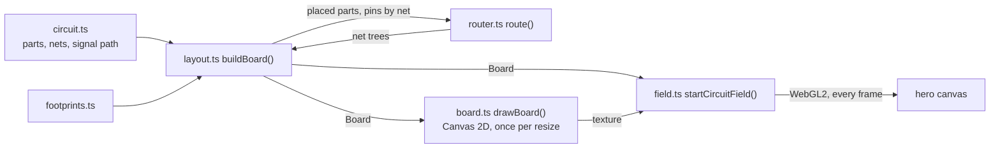
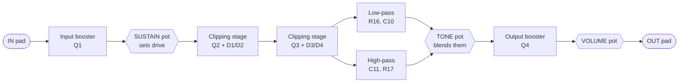
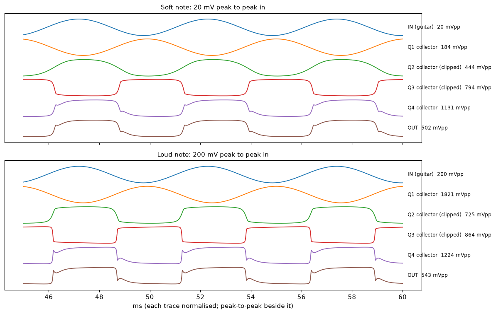

# Circuit field: the hero's circuit board

The landing page's moving background is a real guitar pedal circuit, the Electro-Harmonix Big Muff π fuzz, drawn as a single-sided circuit board with a star ground. Two kinds of current move through it:

- **The signal.** Every few seconds a pulse runs from the `IN` pad through each stage of the circuit to the `OUT` pad, the way a played note does.
- **Ground returns.** Between notes, a few ground pins at a time send a pulse home along the copper to the star ground. They leave timed to arrive together, so where their paths join they merge into one brighter pulse, and the star pad flares when they land.

Everything here is Star Ground's own code. It uses house-style's field canvas and pause button (`.hs-field`, `.hs-motion`) and its `runField`, which applies the motion rules to the drawing, but no shared drawing code and no three.js. This README is the handoff for anyone changing it.

## Contents

1. [Files](#files)
1. [The circuit](#the-circuit)
1. [The signal path](#the-signal-path)
1. [The board layout](#the-board-layout)
1. [Routing](#routing)
1. [The animation](#the-animation)
1. [Rules](#rules)
1. [Making changes](#making-changes)
1. [Checking your work](#checking-your-work)
1. [Simulation](#simulation)
1. [How it got here](#how-it-got-here)
1. [Open ideas](#open-ideas)

## Files

| File                                  | What it holds                                                                                                                                                      |
| ------------------------------------- | ------------------------------------------------------------------------------------------------------------------------------------------------------------------ |
| `circuit.ts`                          | **The source of truth.** Every part: designator, footprint, value, position, rotation, and the net on each pin. Also `SIGNAL_PATH` and `TONE_BRANCH`.              |
| `big-muff.cir`                        | The same circuit as a SPICE netlist, runnable in ngspice. `tests/browser/circuit.spec.ts` fails if it and `circuit.ts` disagree.                                   |
| `footprints.ts`                       | Real through-hole footprints at real sizes: pads in pin order, and silkscreen.                                                                                     |
| `router.ts`                           | A single-layer grid router that lays the copper and records each net as a tree.                                                                                    |
| `layout.ts`                           | `buildBoard()`: places parts, routes nets, and derives the traces, jumpers, and current-flow data the renderer needs.                                              |
| `board.ts`                            | Draws the still board once with Canvas 2D (mask, copper, pads, holes, silkscreen).                                                                                 |
| `field.ts`                            | `startCircuitField()`: fits the board to the hero, uploads it as a texture, and animates current with raw WebGL2, handing the drawing to house-style's `runField`. |
| `geometry.ts`                         | Points, rectangles, quarter turns, and a seeded random generator.                                                                                                  |
| `../../components/CircuitField.astro` | The canvas and pause button, and the script that loads `field.ts` once the page has loaded.                                                                        |

The pipeline, from netlist to pixels:



The board is built once per page load, in about 100 to 150 ms, after the page has loaded and the browser is idle. It's deterministic: the same `circuit.ts` always gives the same board.

## The circuit

### Source

The netlist and values are the early-version Big Muff π drawn in Figure 1 of J.L., [_A Case Study: Re-Engineering the Big Muff π_](https://www.guitarscience.net/papers/bigmuff.pdf) (2014). Later versions changed values (the Big Muff Page and ElectroSmash document them), but the topology is the same. Designators are renumbered in signal order, as a board's silkscreen would be; [Parts](#parts) gives the paper's name for each. Two details aren't in the paper's figure and were chosen here: the clipping diodes are 1N914, a common choice, and the transistor model in `big-muff.cir` is approximate.

A circuit's connections are functional facts, not artwork, so drawing it is fine. The board layout is Star Ground's own; no one's PCB artwork was copied.

### Topology

Five blocks in series, powered from 9 V (`VCC`), with every ground return wired to the star (`GND`):



**The gain stages (Q1, Q2, Q3)** are the same common-emitter amplifier, built by `stage()` in `circuit.ts`. Each has a 47k collector resistor to 9 V, a 470k resistor and a 470 pF capacitor from collector back to base (negative feedback, which sets the gain and rolls off the highs), a 100k resistor from base to ground (bias), and a 100 Ω emitter resistor to ground:

```text
            VCC
             |
            [RC 47k]
             |
   +---------+------- collector (QnC) ---> coupling cap to the next stage
   |         |
 [RB1 470k] [CF 470p]          (both from collector back to base)
   |         |
   +---------+------- base (QnB) <--- input (through C1, or a 10k series resistor)
   |
 [RB2 100k]
   |
  GND            emitter (QnE) --- [RE 100] --- GND
```

**The clipping stages (Q2, Q3)** add a pair of diodes in opposite directions between the collector and a node (`CLIP2`, `CLIP3`) that a 1 µF capacitor (C6, C9) couples back to the base. Once the collector swings more than a diode drop either way, the diodes conduct and feed the swing back, which clips the waveform: the Big Muff's fuzz. Each clipping stage is fed through a 10k resistor (R6, R11), which with the stage's input impedance sets how hard it's driven.

**The sustain pot** sits between Q1 and Q2 as a volume control: Q1's output (via C3) across the pot to ground, with the wiper (via C4) feeding Q2. Turning it up drives the clipping stages harder.

**The tone stack** is passive. Q3's collector feeds both a low-pass filter (R16 27k into C10 10 nF to ground: the `TONE_LP` net) and a high-pass filter (C11 4.7 nF into R17 27k to ground: `TONE_HP`). The tone pot's ends sit on those two nets and its wiper picks a blend, which is the Big Muff's mid-scooped sound.

**The output booster (Q4)** makes up the tone stack's loss. It's a plain common-emitter stage: base biased by R18 470k from 9 V and R19 100k to ground, 10k collector resistor, 2.2k emitter resistor. Its output goes through C13 to the volume pot, whose wiper is the `OUT` pad.

### Nets

Net names are what `circuit.ts`, `big-muff.cir`, and `layout.ts` use. In SPICE, `GND` is node `0`.

| Net               | What it is                                      | Pins on it                                                                               |
| ----------------- | ----------------------------------------------- | ---------------------------------------------------------------------------------------- |
| `IN`              | Input jack tip                                  | IN pad, R1                                                                               |
| `Q1IN`            | Between the input resistor and coupling cap     | R1, C1−                                                                                  |
| `Q1B` `Q1C` `Q1E` | Q1's base, collector, emitter                   | Q1, R2, C2, R3, C1+ / Q1, R2, C2, R4, C3+ / Q1, R5                                       |
| `SUS_TOP`         | Q1's output, across the sustain pot             | C3−, SUSTAIN lug 3                                                                       |
| `SUS_WIPER`       | Sustain pot wiper                               | SUSTAIN wiper, C4−                                                                       |
| `Q2IN`            | Into the first clipping stage                   | C4+, R6                                                                                  |
| `Q2B` `Q2C` `Q2E` | Q2's base, collector, emitter                   | Q2, R6, R7, C5, R8, C6 / Q2, R7, C5, R9, D1 anode, D2 cathode, C7+ / Q2, R10             |
| `CLIP2`           | The diodes' far side, coupled back to Q2's base | C6, D1 cathode, D2 anode                                                                 |
| `Q3IN`            | Into the second clipping stage                  | C7−, R11                                                                                 |
| `Q3B` `Q3C` `Q3E` | Q3's base, collector, emitter                   | Q3, R11, R12, C8, R13, C9 / Q3, R12, C8, R14, D3 anode, D4 cathode, R16, C11 / Q3, R15   |
| `CLIP3`           | The second diode pair's far side                | C9, D3 cathode, D4 anode                                                                 |
| `TONE_LP`         | Low-pass output                                 | R16, C10, TONE lug 1                                                                     |
| `TONE_HP`         | High-pass output                                | C11, R17, TONE lug 3                                                                     |
| `TONE_WIPER`      | Tone pot wiper                                  | TONE wiper, C12−                                                                         |
| `Q4B` `Q4C` `Q4E` | Q4's terminals                                  | Q4, C12+, R18, R19 / Q4, R20, C13+ / Q4, R21                                             |
| `VOL_TOP`         | Q4's output, across the volume pot              | C13−, VOLUME lug 1                                                                       |
| `OUT`             | Output jack tip                                 | VOLUME wiper, OUT pad                                                                    |
| `VCC`             | 9 V supply                                      | 9V pad, R4, R9, R14, R18, R20                                                            |
| `GND`             | Ground: every return meets at the star          | STAR GND pad, R3, R5, SUSTAIN lug 1, R8, R10, R13, R15, C10, R17, R19, R21, VOLUME lug 3 |

The jacks' sleeves and the battery's negative wire land on the star pad itself, which is what makes it a star ground: every ground current returns to one point, so no stage's return current flows through another stage's ground.

### Parts

| Ref                    | Value                          | Paper                     | Role                        |
| ---------------------- | ------------------------------ | ------------------------- | --------------------------- |
| R1                     | 39k                            | RG1                       | Input series resistor       |
| C1                     | 1 µF                           | CB1                       | Input coupling              |
| R2, C2, R3, R4, R5     | 470k, 470 pF, 100k, 47k, 100 Ω | RB11, CF1, RB12, RC1, RE1 | Q1 stage                    |
| Q1                     | BC549C                         | Q1                        | Input booster               |
| C3                     | 1 µF                           | CO1                       | Q1 output coupling          |
| SUSTAIN                | 100k                           | Rsus                      | Drive into the clippers     |
| C4                     | 1 µF                           | CB2                       | Sustain wiper coupling      |
| R6                     | 10k                            | RG2                       | Q2 series input             |
| R7, C5, R8, R9, R10    | 470k, 470 pF, 100k, 47k, 100 Ω | RB21, CF2, RB22, RC2, RE2 | Q2 stage                    |
| C6, D1, D2             | 1 µF, 1N914 × 2                | CR2, D21, D22             | Q2 clipping loop            |
| C7                     | 1 µF                           | CO2                       | Q2 output coupling          |
| R11                    | 10k                            | RG3                       | Q3 series input             |
| R12, C8, R13, R14, R15 | 470k, 470 pF, 100k, 47k, 100 Ω | RB31, CF3, RB32, RC3, RE3 | Q3 stage                    |
| C9, D3, D4             | 1 µF, 1N914 × 2                | CR3, D31, D32             | Q3 clipping loop            |
| R16, C10               | 27k, 10 nF                     | RT, CT                    | Tone low-pass               |
| C11, R17               | 4.7 nF, 27k                    | CB, RB                    | Tone high-pass              |
| TONE                   | 100k                           | Rmix                      | Tone blend                  |
| C12                    | 1 µF                           | CB4                       | Q4 input coupling           |
| R18, R19, R20, R21     | 470k, 100k, 10k, 2.2k          | RB41, RB42, RC4, RE4      | Q4 bias, collector, emitter |
| Q4                     | BC549C                         | Q4                        | Output booster              |
| C13                    | 1 µF                           | CO4                       | Q4 output coupling          |
| VOLUME                 | 500k                           | (unnamed)                 | Output level                |

## The signal path

`SIGNAL_PATH` in `circuit.ts` lists the guitar's route as steps: the part it passes through, the net it enters on, and the net it leaves on. Each step's exit net is the next step's entry net, and a test checks the chain is unbroken from `IN` to `OUT`:

1. `IN` → **R1** → `Q1IN` → **C1** → `Q1B`
1. `Q1B` → **Q1** (base in, collector out) → `Q1C`
1. `Q1C` → **C3** → `SUS_TOP` → **SUSTAIN** (lug to wiper) → `SUS_WIPER` → **C4** → `Q2IN`
1. `Q2IN` → **R6** → `Q2B` → **Q2** → `Q2C` (clipped by D1/D2)
1. `Q2C` → **C7** → `Q3IN` → **R11** → `Q3B` → **Q3** → `Q3C` (clipped by D3/D4)
1. `Q3C` → **R16** → `TONE_LP` → **TONE** (lug to wiper) → `TONE_WIPER`
1. `TONE_WIPER` → **C12** → `Q4B` → **Q4** → `Q4C`
1. `Q4C` → **C13** → `VOL_TOP` → **VOLUME** (lug to wiper) → `OUT`

`TONE_BRANCH` is the high-pass branch, which leaves the main path at `Q3C` and rejoins it at `TONE_WIPER`: `Q3C` → **C11** → `TONE_HP` → **TONE** → `TONE_WIPER`.

On the board, the animated route follows the actual copper between parts (through the net's routed tree) and cuts straight through each part from the pad it enters to the pad it leaves. The feedback parts, the bias resistors, the diodes, and the supply don't carry the animated signal; they're part of the circuit but not the path a note takes.

## The board layout

### Units and conventions

- **Units.** One board unit is 0.1 inch (2.54 mm), the pitch through-hole parts sit on. The board is `BOARD` = 64 × 40 units (6.4 × 4.0 inches). `x` runs right and `y` runs down, from the board's top-left corner.
- **Rotation.** `turns` is quarter turns clockwise. Footprints are drawn with their long axis east, so a resistor at `turns: 1` stands upright with pin 1 at the top, and a pot at `turns: 2` has its lugs in a row with its body hanging below them, off the bottom edge as board-mount pots do.
- **Pin order.** `pins` lists the net on each pad in the footprint's pad order:

| Footprint      | Pads, in order                          | Size                                       |
| -------------- | --------------------------------------- | ------------------------------------------ |
| `resistor`     | 1, 2                                    | Axial, 0.4 inch pitch                      |
| `diode`        | cathode (square, under the band), anode | DO-35, 0.4 inch pitch                      |
| `film-cap`     | 1, 2                                    | Box, 0.2 inch pitch                        |
| `electrolytic` | positive (square), negative             | 5 mm radial, 2 mm pitch                    |
| `transistor`   | emitter, base, collector                | TO-92, 0.1 inch pitch, flat side toward +y |
| `pot`          | lug 1, wiper, lug 3                     | 16 mm board mount, 0.2 inch lug pitch      |
| `terminal`     | the pad                                 | Square wire pad for a jack or the battery  |
| `star`         | the pad                                 | 2.3 unit pad with a silkscreen ring        |

- **Labels.** `label` puts the designator north, south, east, or west of the part's outline (default: east of upright parts, north of the rest). Nothing checks labels for overlaps, so look after moving parts.

### Placement

The board reads left to right in signal order, the way a builder expects:

- **Columns.** Q1's stage at x ≈ 10, Q2's at 24, Q3's at 38, the tone stack at 43 to 48, and Q4 at 54. `stage()` places each gain stage around its transistor at `(ox, 18)`: the collector resistor above it, the feedback pair to its upper left, and the bias and emitter resistors below.
- **Rows.** The 9 V supply runs along the top, the diode pairs sit above their stages, and the star ground is at the bottom middle (29.5, 28.5), between the second and third stages, where returns from both halves of the board are short.
- **Edges.** The three pots line the bottom edge, as on a real enclosure's face. The IN and 9V pads are on the left edge, and OUT is at the bottom right.

## Routing

`router.ts` lays the copper the way a careful hand layout looks:

- **Grid.** A 0.05 inch grid (`GRID` = 0.5 units). A trace moves in the eight PCB directions only, a 45 degree turn costs a little, a 90 degree turn costs more, and anything sharper is forbidden. Traces keep `CLEARANCE` (0.3 units, 30 mil) from other nets' copper, and pay a little extra to run close to it, so they spread out.
- **One net at a time.** Each net grows as a tree from its root pin (the star for `GND`, the 9V pad for `VCC`, the first-listed pin otherwise). Each remaining pin, nearest first, is joined to the tree by the cheapest path (Dijkstra over cell and heading). Pads join the tree whole, so traces can meet a pad anywhere on it.
- **Order** (`layout.ts`): short signal nets first, then ground, then the supply. Routing ground or supply first walls the board off and forces long detours.
- **Jumpers.** When a net can't get through, the search may hop a straight wire jumper (2 to 8 units long) between two free pad sites, at a cost (`JUMPER_COST` = 12) that makes it worth it only for a real detour. Jumpers are drawn as silkscreen lines between two pads, as single-sided boards print them.
- **Wide copper.** `VCC` and `GND` are 0.6 units wide (60 mil), signals 0.4.
- **Results today:** every pin routed, 4 jumpers, about 420 units of copper. The test allows at most 4 jumpers; if a change needs more, improve the placement rather than raising the limit.

Each routed net keeps, per copper cell, its parent toward the root and its distance along the copper to the root. The animation is built from those trees.

## The animation

### Current as distance

Every animated piece of copper is a `FlowSegment`: two endpoints, the distance still to travel at each end (`da`, `db`), and a range of sources (`first` to `last`) whose current flows through it. Pads that light up are `FlowPad`s with one distance. A pulse is an event: a source, the time it arrives, a speed, and a strength. At any moment, a fragment at distance `d` on a segment that carries the event's source is lit by:

```text
x = d − (arrival − now) × speed            how far behind the pulse's head this point is
brightness += strength × (x < 0 ? exp(x / HEAD) : exp(−x / tail))
```

So the head is sharp (`HEAD` = 0.6 units ahead) and the tail trails behind (`TAIL` = 7 units at ground speed, longer for faster pulses). Brightness from all events sums and saturates (`1 − exp(−sum)`), which is why merged pulses look brighter but never blow out.

**Ground.** Distances run to the star along the ground tree. The ground pins are numbered depth-first from the star, so every cell's feeders are one contiguous range of ids. A segment then needs only `first` and `last`, and the shader's test is a range check. A ground wave picks two to four pins and gives them the same arrival time, so their pulses meet wherever their paths join and reach the star together.

**Signal.** One source id (after the ground pins), with distance measured to the `OUT` pad along the whole route. The tone branch's distances are stretched to start and end where the main path's do, so both reach the tone pot's wiper together.

### Drawing

- **The still board** is drawn once per resize with Canvas 2D (`board.ts`) at device resolution and uploaded as a texture. Each frame draws it as one full-screen triangle.
- **The current** is one instanced draw: every segment and lit pad is a quad expanded around its centreline in the vertex shader. The fragment shader works out the distance to the segment (round caps), the copper's edge, a faint halo, the drill hole for pads, and the pulse brightness above. Blending is `MAX`, so overlapping caps at bends don't double up.
- **Instance data**, ten floats each: `ax ay bx by` (device px), `radius drill da db` (radius and drill in px), `first last`. The star pad is the last instance, with `first = -1`, lit by a CPU-computed `uStar` that flares on each ground arrival.
- **Events** are `vec4`s (`source, seconds until arrival, speed, strength`), at most `MAX_EVENTS` = 64, sent as a uniform array each frame. Times are relative to now, so float precision never degrades.

### Tuning, in `field.ts`

| Constant                      | Now                                                                                                                       | Effect                                                   |
| ----------------------------- | ------------------------------------------------------------------------------------------------------------------------- | -------------------------------------------------------- |
| `GROUND_SPEED`                | 9 units/s                                                                                                                 | How fast returns travel                                  |
| `SIGNAL_SPEED`                | 30 units/s                                                                                                                | How fast a note crosses the board (about 9 s end to end) |
| `HEAD`, `TAIL`                | 0.6, 7                                                                                                                    | Pulse shape                                              |
| Signal interval               | 3.2 to 5.6 s                                                                                                              | `schedule()`                                             |
| Ground wave interval and size | 1.4 to 3.2 s, 2 to 4 pins                                                                                                 | `schedule()`                                             |
| Board colours                 | mask, edge, copper, pads, silk alphas                                                                                     | `applyStyle()`                                           |
| Strength                      | `--hs-field-strength` (0.36) scaled by 1.6 for the board and 2.4 for the current                                          | `draw()`                                                 |
| Placement in the hero         | right half of the content column above 900 px; full width at the bottom below                                             | `layout()`                                               |
| Text guard                    | fades the board toward the copy: from 34 to 66 % across on wide screens, 56 to 86 % down on narrow ones, never below 10 % | `GUARD` shader                                           |

### Lifecycle

`CircuitField.astro` imports `field.ts` through house-style's `afterLoad`, after the page's load event once the browser is idle (or a second after load at the latest), so the first screen paints as text. `startCircuitField()` returns nothing when WebGL2 is unavailable (the hero keeps its plain background, and the pause button stays hidden), and otherwise hands its drawing to house-style's `runField`, which follows the motion rules: still for reduced motion, paused off screen and in hidden tabs, stoppable with the pause button, and freed when client-side navigation removes the canvas. When the GPU resets or a phone reclaims memory, the WebGL context is lost; `runField` stops drawing until the browser restores it, then calls the scene's `restore()`, which builds the programs, texture, and buffers again and lays the board out on the next resize. `prime()` back-dates the first events so the first frame already has current in it.

## Rules

- **Keep the circuit real.** Change parts, values, or connections only to match a cited schematic, and update `big-muff.cir` in the same change; the test enforces that they agree. Layout (positions, rotations, labels) is free to change.
- **No 3D libraries.** Raw WebGL2 only. The whole field is one script of about 25 KB; three.js was roughly 600 KB.
- **House-style motion rules.** Below the text in contrast, still for reduced motion, paused off screen, with a working pause button. Don't remove the text guard.
- **Deterministic.** No `Math.random()`; use `seeded()`, so the board and the motion are the same on every visit and in tests.
- **Don't copy board artwork.** Circuits are fine to draw; another designer's PCB layout isn't. See [How it got here](#how-it-got-here).

## Making changes

- **Move a part or tidy the layout.** Edit its `at`, `turns`, or `label` in `circuit.ts`, then run the circuit test (routing must still succeed with at most 4 jumpers) and look at the board (see below). Prefer moving parts over adding jumpers.
- **Change a value.** Only to match a source; change `circuit.ts` and `big-muff.cir` together.
- **Add a part,** for example a supply filter capacitor and reverse-polarity diode, which many real Big Muff boards have: add it to `circuit.ts` with its pins' nets, add the matching line to `big-muff.cir`, and cite the version it comes from.
- **Draw a different circuit.** Replace `circuit.ts` (parts, `SIGNAL_PATH`, any branches) and `big-muff.cir`, keep the `GND` and `VCC` net names (the router roots them at the star and the 9V pad), and update `signalFlow()` in `layout.ts` if the branches differ: it currently names `Q3`, `Q3C`, `TONE`, and `TONE_WIPER` for the tone branch.
- **Add a footprint.** Add it to `FOOTPRINTS` in `footprints.ts` at its real size, with pads in pin order, and to the table above.
- **Retune the motion.** The constants in [Tuning](#tuning-in-fieldts). Keep the result calm: a pulse every few seconds, not a light show.

## Checking your work

- **Tests.** `tests/browser/circuit.spec.ts` checks that the SPICE netlist matches `circuit.ts` part for part, that the signal path is unbroken, and that the board routes completely with at most 4 jumpers. `tests/browser/pages.spec.ts` checks that the field's script loads only after the page has. Run them with `npm run test:browser` in `web/`.
- **Look at the board.** Start the dev server (`npx astro dev` in `web/`), open the page, and run this in the browser console to draw the board alone, large, over the page:

```js
const { buildBoard } = await import('/src/lib/circuit-field/layout.ts');
const { drawBoard } = await import('/src/lib/circuit-field/board.ts');
const b = buildBoard();
const c = Object.assign(document.createElement('canvas'), {
  width: innerWidth,
  height: innerHeight,
});
Object.assign(c.style, { position: 'fixed', inset: '0', zIndex: 9999, background: '#0a0c0e' });
const u = Math.min((innerWidth - 16) / b.width, (innerHeight - 16) / b.height);
drawBoard(c.getContext('2d'), b, {
  unit: u,
  origin: { x: 8, y: 8 },
  font: 'monospace',
  mask: 'rgba(74,222,128,0.06)',
  edge: 'rgba(230,237,243,0.4)',
  copper: 'rgba(74,222,128,0.55)',
  pad: 'rgba(230,237,243,0.75)',
  silk: 'rgba(230,237,243,0.6)',
});
document.body.append(c);
console.log({ jumpers: b.jumpers.length, failed: b.failed });
```

- **Simulate the circuit.** `ngspice -b big-muff.cir` prints the DC bias, each stage's swing for a note, and the output's harmonics. Compare them with [Simulation](#simulation).

## Simulation

`big-muff.cir` was run in ngspice 47 on 2026-10-25, with all three pots at noon and a 196 Hz note (G3) on the input. The results show the circuit behaves as a Big Muff should, so the netlist, and the board drawn from it, are wired correctly.

DC bias:

| Point                       | Volts            | Why                                                                               |
| --------------------------- | ---------------- | --------------------------------------------------------------------------------- |
| Q1, Q2, Q3 bases            | 0.61             | One base-emitter drop                                                             |
| Q1, Q2 collectors           | 3.61             | Collector-to-base feedback holds each at about V<sub>BE</sub> × (1 + 470k / 100k) |
| Q3 collector                | 3.55             | The same, slightly loaded by the tone stack                                       |
| `TONE_LP`                   | 2.93             | Q3's collector through R16, the tone pot, and R17                                 |
| Q4 base, emitter, collector | 1.52, 0.88, 5.02 | The 470k / 100k divider, a base-emitter drop below it, and 10k of collector load  |

Each stage's swing, peak to peak:

| Input                | Q1 collector | Q2 collector | Q3 collector | Q4 collector | OUT    | Output distortion |
| -------------------- | ------------ | ------------ | ------------ | ------------ | ------ | ----------------- |
| 20 mV (a soft note)  | 0.18 V       | 0.44 V       | 0.79 V       | 1.13 V       | 0.50 V | 26 %              |
| 200 mV (a hard pick) | 1.82 V       | 0.73 V       | 0.86 V       | 1.22 V       | 0.54 V | 30 %              |

What that shows:

- **Sustain.** Ten times more input gives only 8 % more output: the clipping stages compress, which is why the pedal sustains notes.
- **Diode clipping.** On the loud note, Q1 swings 1.8 V but Q2's collector is held to 0.7 V: the diode pair conducts beyond about a diode drop either way.
- **Symmetric clipping.** The output's harmonics are almost all odd (third about 25 % of the fundamental, fifth 12 %, seventh 9 %), with every even harmonic under 1 %, the signature of a back-to-back diode pair.

The waveforms at each stage, from the same runs (each trace scaled to the same height, with its peak-to-peak swing beside it). Every stage inverts the signal; by Q3's collector even the soft note has been squared off, and the output keeps that shape whichever note goes in:



To redraw it, add `wrdata out.csv v(in) v(q1c) v(q2c) v(q3c) v(q4c) v(out)` after the `tran` line in `.control`, run ngspice with its input closed (`ngspice -b big-muff.cir < /dev/null`, or it can wait on the terminal), and plot each column pair as time and voltage.

The transistor model is approximate, so treat the numbers as the circuit's character rather than a specific pedal's measurements.

## How it got here

1. **House-style's attractor field (three.js).** Protostar's landing page uses a moving Dadras attractor drawn with three.js, and house-style v2 shared it. Star Ground wanted something that said "pedals", and something lighter than three.js.
1. **A generated board.** The first attempt generated a board procedurally: ground trunks radiating from a star in the eight PCB directions, parts along them, signal traces between. It looked like a PCB at a glance but not like a circuit, because its connections were random. Rejected.
1. **Fetching a real board.** Openly licensed pedal PCBs turned out to be scarce or unsuitable: a tiny MIT-licensed single-transistor fuzz with traces at arbitrary angles and ground on a pour, GPL-3.0 boards (not compatible with Star Ground's MIT license, and one repository's board file was an empty placeholder), and one tiny CERN-OHL board. Most real pedal boards also ground through a copper pour, not a star.
1. **A real circuit, laid out here.** Taking a famous circuit's published schematic and laying it out as a builder would gives real connections and a genuine star ground without copying anyone's artwork. The Big Muff π was chosen over the Fuzz Face for its density: four stages and about 45 parts, against about ten.
1. **The router.** Its first version allowed jumpers only after a jumper-free route failed, which sent nets on long detours around the board's edge (21 jumpers, 730 units of copper). Weighing jumpers against detours in one search, and routing short signal nets before ground and supply, brought it to 4 jumpers and about 420 units.

## Open ideas

- **Values on the silkscreen.** Many DIY boards print values ("47k") beside designators; `PartSpec.value` already has them.
- **Signal shape.** The signal pulse is the same before and after the clipping stages. It could visibly change after the diodes (brighter, wider, or doubled) to show distortion.
- **Supply current.** `VCC` isn't animated. A slow, faint flow from the 9V pad into the collector resistors would complete the picture.
- **Label overlap checks.** Labels are placed by hand; a check in the circuit test for silkscreen overlapping pads or other labels would catch mistakes.
- **Mid-width overlap.** Around 1000 px wide, the board's left edge sits faintly behind the hero paragraph. The text guard keeps it readable, but the board could shrink or start further right at those widths.
- **Router speed.** The search is Dijkstra over every cell and heading. An A* heuristic toward the nearest tree cell would make it faster if the board grows.
